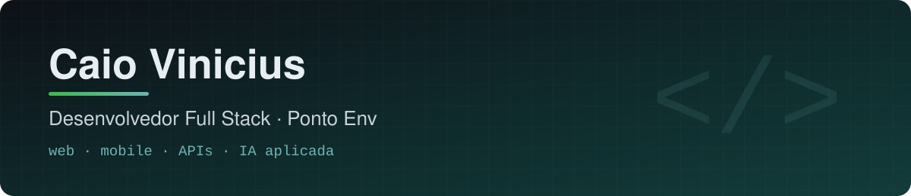

  
  
  
  

## Sobre mim

- 💼 **Desenvolvedor Full Stack na [Ponto Env](https://pontoenv.com.br)** há 1 ano: web, mobile e APIs em produção.
- 🎓 Cursando **Sistemas de Informação** na Uninassau, em Juazeiro do Norte (CE).
- 🤖 Interesse em **IA aplicada**: modelos que rodam no próprio dispositivo e ferramentas de IA no fluxo de desenvolvimento.
- 📍 Ceará, Brasil.

## Projeto em destaque

<table>
  <tr>
    <td width="150" align="center">
      
    </td>
    <td>
      <h3><a href="https://github.com/Caiorhcp/sapo-juridico">S.A.P.O. – Sistema de Análise de Peças Offline</a></h3>
      Analisa peças processuais <b>dentro do navegador</b>: classifica o documento, monta a ficha do processo
      (partes, dispositivo, prazos em dias úteis, valores), detecta e anonimiza dados pessoais (LGPD), consulta o
      andamento no Datajud/CNJ e gera relatório em PDF. O modelo foi treinado com 149 mil páginas reais do STF e
      supera o baseline publicado (F1 macro 78,2 contra 76,3).
        
      
      
      
      
      
    </td>
  </tr>
</table>

## Stacks

**Linguagens** 

**Front-end e mobile** 

**Back-end e dados** 

**IA e machine learning** 

**Ferramentas** 

## Estatísticas

<picture>
  <source media="(prefers-color-scheme: dark)" srcset="assets/cobrinha-escura.svg">
  
</picture>

Gráficos gerados diariamente por GitHub Actions neste repositório, incluindo contribuições em repositórios privados.
